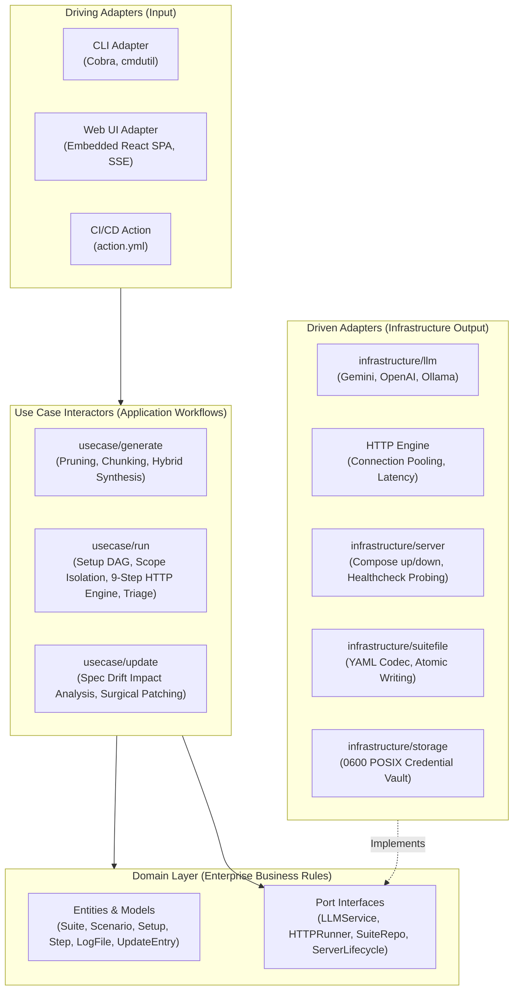

# System Architecture

SpecTest is built on **Clean Architecture** (Hexagonal / Ports & Adapters), adhering strictly to **The Dependency Rule**: source code dependencies always point inwards towards pure domain entities.

---

## Architectural Layers

---

## Layer Responsibilities

### 1. Domain Layer (`internal/domain`)
- **Pure Go**: Contains zero external imports, no YAML codecs, no HTTP clients, and no Docker code.
- **Entities**:
  - `Suite` (v1 schema) & `MutableSuite`: Captures the test suite contract (`servers`, `apis`, `analysis`, `seed`, `setup`, `scenarios`).
  - `Scenario`: Executable business journey with stable kebab-case `id`, `setup` dependencies, and `steps`.
  - `Setup`: Reusable pre-execution blocks declaring dependency sets via `use: [...]`.
  - `Step`: Single HTTP call (`call`, `expect`, `headers`, `body`, `save`).
  - `LogFile`, `BaseEntry`, `UpdateEntry`: Append-only history records tracking revisions and cryptographic hashes.
- **Port Interfaces**: Contracts decoupling the domain from infrastructure (`LLMService`, `SuiteRepository`, `ServerLifecycleManager`).

### 2. Use Case Layer (`internal/usecase`)
- **`generate`**: Coordinates OpenAPI pruning, context chunking, auth detection, LLM scenario synthesis, and incremental update mode (catalog reconstruction, deterministic diffing, impact graph resolution, contract repairs).
- **`run`**: Orchestrates setup DAG resolution (`dag.go`), runtime scope isolation (`scope.go`), the 9-step single step execution pipeline (`step.go`), selection mode (`selection.go`), and AI defect triage (`triage.go`).

### 3. Infrastructure Layer (`internal/infrastructure`)
- **`suitefile`**: Canonical YAML codecs for `spectest.yaml` and `spectest.log.yaml`.
- **`openapi`**: Deterministic pruner, OpenAPI chunker, and authentication detector.
- **`llm`**: Multi-provider client abstraction supporting Google Gemini, OpenAI, and local Ollama instances.
- **`server`**: Healthcheck probe loops and automated Docker Compose process lifecycle management.
- **`storage`**: POSIX `0600` credential store.

### 4. Adapter Layer (`internal/adapter`)
- **`cli`**: Cobra commands (`spectest generate`, `run`, `config`, `ui`) providing flag parsing and stdout telemetry.
- **`ui`**: Embedded HTTP server, SSE broadcaster, and static asset server delivering the React dashboard.

### 5. Platform Layer (`internal/platform`)
- **`atomicfile`**: Crash-safe atomic file writing using temp files and atomic rename.
- **`buildinfo`**: Binary version, Git commit hash, and build timestamp.
- **`logger`**: Structured `slog` wrapper supporting debug verbosity.
