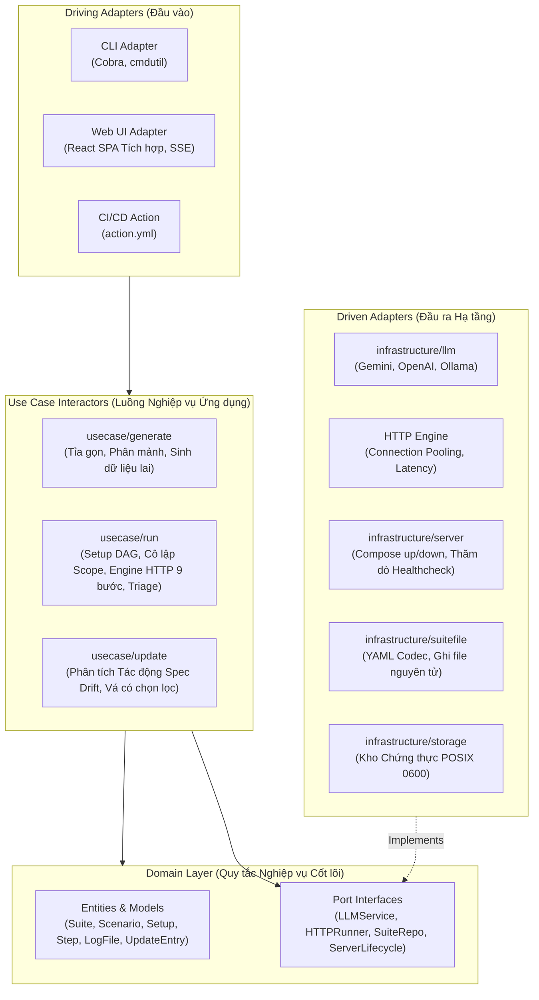

# Kiến trúc Hệ thống

SpecTest được xây dựng tuân thủ nghiêm ngặt mô hình **Clean Architecture** (Hexagonal / Ports & Adapters), đáp ứng chuẩn tắc **Quy tắc Phụ thuộc (The Dependency Rule)**: các phụ thuộc mã nguồn luôn trỏ vào bên trong về phía các thực thể domain cốt lõi.

---

## Sơ đồ Phân tầng Kiến trúc

---

## Trách nhiệm của Từng Phân tầng

### 1. Tầng Domain (`internal/domain`)
- **Go Thuần túy**: Không chứa bất kỳ thư viện bên thứ ba nào, không phụ thuộc thư viện parse YAML, client HTTP hay Docker.
- **Entities**:
  - `Suite` (schema v1) & `MutableSuite`: Nắm giữ hợp đồng của test suite (`servers`, `apis`, `analysis`, `seed`, `setup`, `scenarios`).
  - `Scenario`: Kịch bản nghiệp vụ có `id` dạng kebab-case ổn định, phụ thuộc `setup` và các bước `steps`.
  - `Setup`: Khối chuẩn bị dữ liệu tái sử dụng khai báo tập phụ thuộc qua `use: [...]`.
  - `Step`: Bước kiểm thử HTTP đơn lẻ (`call`, `expect`, `headers`, `body`, `save`).
  - `LogFile`, `BaseEntry`, `UpdateEntry`: Các bản ghi lịch sử ghi nối tiếp theo dõi các phiên bản và mã băm mật mã.
- **Port Interfaces**: Các hợp đồng giao tiếp độc lập với hạ tầng (`LLMService`, `SuiteRepository`, `ServerLifecycleManager`).

### 2. Tầng Use Case (`internal/usecase`)
- **`generate`**: Điều phối việc tỉa gọn OpenAPI, phân mảnh context, phát hiện xác thực, sinh kịch bản bằng LLM và chế độ cập nhật tăng dần (tái tạo catalog, so lệch API tất định, giải quyết đồ thị tác động, sửa đổi hợp đồng).
- **`run`**: Điều phối giải DAG setup (`dag.go`), cô lập scope (`scope.go`), thực thi pipeline HTTP 9 bước (`step.go`), chế độ chọn kịch bản (`selection.go`) và chẩn đoán lỗi AI (`triage.go`).

### 3. Tầng Hạ tầng (Infrastructure - `internal/infrastructure`)
- **`suitefile`**: Codec YAML chuẩn tắc cho `spectest.yaml` và `spectest.log.yaml`.
- **`openapi`**: Bộ tỉa gọn tất định, phân mảnh OpenAPI và phát hiện endpoint auth.
- **`llm`**: Trừu tượng hóa multi-provider hỗ trợ Google Gemini, OpenAI và Ollama cục bộ.
- **`server`**: Vòng lặp thăm dò healthcheck và quản lý tiến trình Docker Compose.
- **`storage`**: Kho lưu trữ credentials phân quyền POSIX `0600`.

### 4. Tầng Adapter (`internal/adapter`)
- **`cli`**: Các lệnh Cobra (`spectest generate`, `run`, `config`, `ui`) xử lý cờ lệnh và xuất telemetry ra terminal.
- **`ui`**: HTTP server tích hợp, bộ phát SSE và server phục vụ file tĩnh giao diện React dashboard.

### 5. Tầng Platform (`internal/platform`)
- **`atomicfile`**: Ghi file nguyên tử (atomic write) an toàn bằng file tạm và đổi tên để tránh hỏng dữ liệu khi crash.
- **`buildinfo`**: Thông tin phiên bản binary, Git commit SHA và ngày build.
- **`logger`**: Bộ bọc `slog` có cấu trúc hỗ trợ debug mức độ chi tiết.
