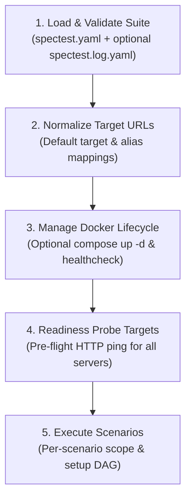
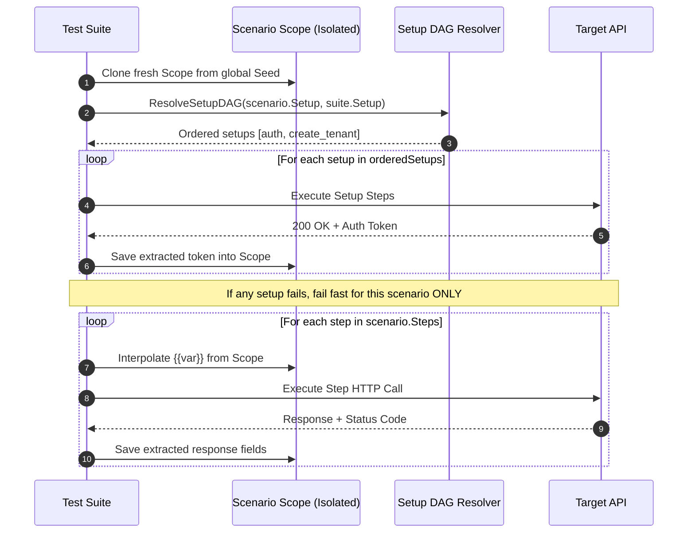

# Execution Lifecycle

The **SpecTest Execution Engine** (`internal/usecase/run/runner.go`) orchestrates the end-to-end testing workflow with strict target validation, setup dependency resolution (DAG), per-scenario scope isolation, and multi-tier evaluation.

---

## High-Level Execution Pipeline

When `spectest run` executes, it progresses through five deterministic phases:



### Phase 1: Load Suite & Selection Mode
- Natively parses `spectest.yaml` into domain models.
- If `--only-changed` is enabled:
  - Reads `spectest.log.yaml` to find the latest update entry (`latest`).
  - Verifies that `currentHash == latest.AfterHash`.
  - Determines affected scenarios:
    - If `Seed` changed $\rightarrow$ executes all scenarios.
    - If `Setup` changed $\rightarrow$ executes all scenarios depending on that setup block.
    - If `Scenario` changed $\rightarrow$ executes modified scenarios.

### Phase 2: Normalize Target URLs
- Normalizes all `-t alias=url` and default `-t url` flags.
- Validates URL syntax, trims trailing slashes, and verifies no duplicate alias keys.

### Phase 3: Docker Compose Lifecycle (Optional)
- If `--compose` is supplied, invokes `LifecycleFactory(composeFile, probeURL, timeoutSec)`.
- Spins up containers in the background (`docker compose up -d`).
- Registers a `defer teardown()` hook to guarantee `docker compose down -v` executes even on failures or `SIGINT` (Ctrl-C).

### Phase 4: Pre-Flight Target Readiness Probing
- Aggregates all unique target URLs.
- Executes `Probe(ctx, targetURL, timeout)` across every endpoint.
- If any target server fails to respond within `--timeout`, execution aborts immediately before any test steps run.

### Phase 5: Execute Scenarios
- Iterates through the selected scenarios sequentially.

---

## Scenario Execution & Scope Isolation

To prevent test flakiness caused by cross-scenario state pollution, SpecTest enforces **strict scope isolation**:



### 1. Fresh Scope per Scenario
Each scenario receives a newly cloned `Scope` containing only the global `Seed` variables. Variables written during Scenario A are never visible to Scenario B.

### 2. Setup Dependency DAG (`ResolveSetupDAG`)
Setups can depend on other setups using the `use: [...]` field. SpecTest computes the transitive closure, validates that all nodes exist, and executes a **DFS topological sort**:
- Automatically orders setups so dependencies run before dependees (e.g. `auth` before `create_order`).
- Detects circular dependencies (e.g., `A -> B -> A`) and reports an error before running any HTTP requests.

### 3. Scenario Fail-Fast Rule
If any setup step fails within a scenario:
- That scenario is immediately marked as failed.
- The remaining steps of that scenario are skipped.
- **Independent scenarios continue running normally**. One broken setup does not block other unaffected test journeys.

---

## The 9-Step Single Step Execution Pipeline

Each HTTP step (`executeSingleStep`) follows a strict 9-step execution pipeline:

```text
[1. Parse Call] ──> [2. Resolve Host] ──> [3. Interpolate URL]
                                                  │
[6. Build Request] <── [5. Interpolate Body] <── [4. Interpolate Headers]
       │
[7. Dispatch & Latency] ──> [8. Limit Read (1MB)] ──> [9. Oracle & AI Triage]
```

### Step 1: Parse Call
Splits `step.Call` into HTTP `Method` and `rawPath` (e.g. `"POST {shop}/api/orders"` $\rightarrow$ `POST` and `{shop}/api/orders`). Defaults to `GET` if no method is declared.

### Step 2: Resolve Host / Server Alias
Matches `{server}` against mapped `--target` aliases:
- `{shop}/path` $\rightarrow$ resolves using `-t shop=http://localhost:8001`.
- Relative path `/path` $\rightarrow$ prepends the default target URL.
- Validates that the resolved URL is an absolute `http://` or `https://` address.

### Step 3: Interpolate URL & Redact
Replaces `{{variable}}` and `{{random}}` placeholders. Sensitive query parameters and tokens are redacted before saving to execution records.

### Step 4: Interpolate Headers & Auto-Content-Type
Substitutes variables inside request headers. If a JSON body is present and no `Content-Type` is declared, automatically sets `Content-Type: application/json`.

### Step 5: Interpolate Body (Preserving Primitive Types)
Recursively traverses maps, arrays, and primitive values. If a field exactly matches `"{{var}}"`, the original runtime type (integer, boolean, float) is preserved rather than converted into a string.

### Step 6: Construct Request with Context
Builds an `http.Request` tied to `ctx`. If the operator presses `Ctrl-C` or the timeout expires, the in-flight request is immediately canceled.

### Step 7: Execute HTTP Request & Measure Latency
Sends the request using connection-pooled HTTP clients and records response duration in milliseconds (`LatencyMs`). Uses `defer resp.Body.Close()` to prevent connection leaks.

### Step 8: Read Response Body with 1MB Limit (`LimitReader`)
Reads the response body using `io.LimitReader(resp.Body, 1MB + 1)`:
- Protects runner memory from out-of-memory (OOM) crashes if an API returns unexpectedly massive payloads.
- If payload exceeds 1MB, truncates and appends `[TRUNCATED: response body exceeded 1MB limit]`.
- Redacts sensitive keys before storing in reports.

### Step 9: Oracle Evaluation & AI Defect Triage
- **Success (`resp.StatusCode == step.Expect`)**:
  - Marks step as passed.
  - Evaluates `step.Save` expressions (`body.<path>`, `header.<name>`) and stores extracted values into the scenario scope.
- **Failure (`resp.StatusCode != step.Expect`)**:
  - Marks step as failed with status discrepancy details.
  - If `--triage` is enabled and an LLM is configured, triggers **AI Defect Triage** (`DiagnoseFailure`) to analyze request/response context and suggest root cause fixes.
