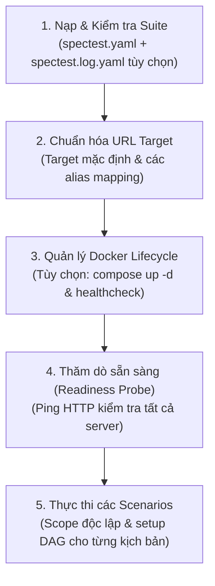
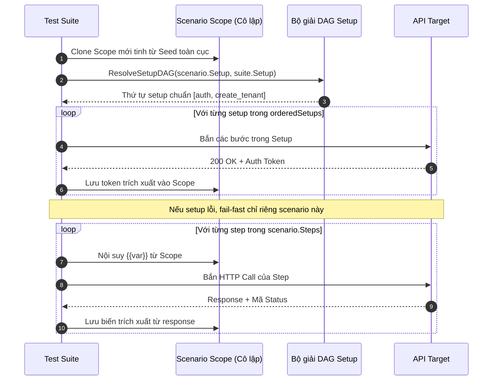

# Vòng đời Thực thi

**Engine Thực thi của SpecTest** (`internal/usecase/run/runner.go`) điều phối toàn bộ quy trình kiểm thử với các bước kiểm tra target chặt chẽ, giải quyết phụ thuộc setup (DAG), cô lập scope của từng kịch bản và đánh giá kết quả nhiều tầng.

---

## Pipeline Thực thi Tổng thể

Khi lệnh `spectest run` khởi chạy, hệ thống đi qua 5 giai đoạn tất định:



### Pha 1: Nạp Suite & Lựa chọn Kịch bản
- Parse file `spectest.yaml` thành domain model.
- Nếu bật cờ `--only-changed`:
  - Đọc `spectest.log.yaml` để lấy bản ghi cập nhật mới nhất (`latest`).
  - Kiểm tra tính toàn vẹn: `currentHash == latest.AfterHash`.
  - Phân tích các scenario bị ảnh hưởng:
    - Nếu `Seed` đổi $\rightarrow$ chạy toàn bộ kịch bản.
    - Nếu `Setup` đổi $\rightarrow$ chạy tất cả scenario có phụ thuộc (`use`) vào setup đó.
    - Nếu `Scenario` đổi $\rightarrow$ chạy các kịch bản bị sửa đổi.

### Pha 2: Chuẩn hóa URL Target
- Chuẩn hóa các cờ `-t alias=url` và target mặc định `-t url`.
- Validate cú pháp URL, xóa bỏ dấu gạch chéo cuối (`/`) và chặn trùng lặp alias.

### Pha 3: Vòng đời Docker Compose (Tùy chọn)
- Nếu có cờ `--compose`, gọi `LifecycleFactory(composeFile, probeURL, timeoutSec)`.
- Khởi động các container dưới nền (`docker compose up -d`).
- Đăng ký hook `defer teardown()` để đảm bảo `docker compose down -v` luôn được gọi khi kết thúc, ngay cả khi gặp lỗi hoặc người dùng bấm `Ctrl-C` (`SIGINT`).

### Pha 4: Thăm dò sẵn sàng trước khi chạy (Readiness Probe)
- Tập hợp danh sách các URL target duy nhất.
- Chạy `Probe(ctx, targetURL, timeout)` ping thử từng endpoint.
- Nếu có bất kỳ server nào không phản hồi trong khoảng `--timeout`, quá trình kiểm thử sẽ hủy ngay trước khi gửi bất kỳ step nào.

### Pha 5: Thực thi các Scenarios
- Duyệt tuần tự qua các kịch bản đã được chọn.

---

## Thực thi Scenario & Cô lập Scope

Để loại bỏ hoàn toàn hiện tượng test flaky do ô nhiễm trạng thái giữa các kịch bản, SpecTest áp dụng cơ chế **cô lập Scope nghiêm ngặt**:



### 1. Scope Mới Tinh cho mỗi Scenario
Mỗi scenario nhận được một phiên bản `Scope` độc lập được nhân bản từ các biến `Seed` toàn cục. Biến sinh ra trong Scenario A tuyệt đối không thể nhìn thấy hoặc làm bẩn Scenario B.

### 2. Đồ thị Phụ thuộc Setup (`ResolveSetupDAG`)
Các setup có thể phụ thuộc lẫn nhau thông qua trường `use: [...]`. SpecTest tính toán bao đóng phụ thuộc, kiểm tra sự tồn tại của các khối và chạy **thuật toán sắp xếp tô-pô bằng DFS**:
- Tự động sắp xếp để setup cha chạy trước setup con (ví dụ `auth` chạy trước `create_order`).
- Phát hiện các vòng lặp phụ thuộc lẩn quẩn (ví dụ: `A -> B -> A`) và trả về lỗi ngay trước khi bắn HTTP.

### 3. Quy tắc Fail-Fast ở cấp Scenario
Nếu bất kỳ bước setup nào của một scenario bị lỗi:
- Kịch bản đó bị đánh trượt ngay lập tức.
- Toàn bộ các bước kiểm thử chính còn lại của kịch bản đó bị bỏ qua.
- **Các kịch bản độc lập phía sau vẫn tiếp tục chạy bình thường**. Một setup bị hỏng không làm tê liệt toàn bộ lượt test.

---

## Pipeline 9 Bước Thực thi Một Bước HTTP

Mỗi bước kiểm thử HTTP (`executeSingleStep`) trải qua 9 bước xử lý tuần tự:

```text
[1. Parse Call] ──> [2. Resolve Host] ──> [3. Nội suy URL]
                                                  │
[6. Tạo Request] <── [5. Nội suy Body] <── [4. Nội suy Headers]
       │
[7. Bắn HTTP & Đo latency] ──> [8. Đọc giới hạn (1MB)] ──> [9. Oracle & AI Triage]
```

### Bước 1: Parse Call
Tách chuỗi `step.Call` thành HTTP `Method` và đường dẫn `rawPath` (ví dụ `"POST {shop}/api/orders"` $\rightarrow$ `POST` và `{shop}/api/orders`). Mặc định là `GET` nếu không ghi rõ method.

### Bước 2: Phân giải Host / Alias Máy chủ
Khớp `{server}` với danh sách alias đã truyền qua `--target`:
- `{shop}/path` $\rightarrow$ giải quyết bằng `-t shop=http://localhost:8001`.
- Đường dẫn tương đối `/path` $\rightarrow$ ghép vào target mặc định.
- Xác thực URL sau khi ghép bắt buộc phải là một địa chỉ tuyệt đối bắt đầu bằng `http://` hoặc `https://`.

### Bước 3: Nội suy URL & Che giấu thông tin (Redaction)
Thay thế các placeholder `{{variable}}` và `{{random}}`. Các token và tham số truy vấn nhạy cảm được che giấu (`[REDACTED]`) trước khi lưu vào nhật ký thực thi.

### Bước 4: Nội suy Headers & Tự động thêm Content-Type
Thay thế biến trong request headers. Nếu có body JSON mà chưa khai báo `Content-Type`, hệ thống tự động gán `Content-Type: application/json`.

### Bước 5: Nội suy Body (Giữ nguyên Kiểu Dữ liệu Gốc)
Duyệt đệ quy qua các map, mảng và giá trị nguyên thủy. Nếu một trường có giá trị đúng bằng `"{{var}}"`, kiểu dữ liệu Go gốc (int, boolean, float) sẽ được giữ nguyên thay vì bị ép thành kiểu chuỗi.

### Bước 6: Tạo HTTP Request gắn Context
Khởi tạo đối tượng `http.Request` gắn với `ctx`. Nếu người dùng hủy lệnh (`Ctrl-C`) hoặc quá thời gian chờ, request đang gửi dở sẽ bị hủy ngay lập tức.

### Bước 7: Thực thi Request & Đo Độ trễ
Bắn request qua HTTP client có connection-pooling và đo thời gian phản hồi bằng mili giây (`LatencyMs`). Sử dụng `defer resp.Body.Close()` để chống rò rỉ socket.

### Bước 8: Đọc Response Body có Giới hạn 1MB (`LimitReader`)
Đọc response body thông qua `io.LimitReader(resp.Body, 1MB + 1)`:
- Bảo vệ RAM của test runner không bị tràn (OOM) nếu server mục tiêu vô tình trả về payload quá lớn.
- Nếu vượt quá 1MB, runner cắt phần dư và gắn thêm chuỗi `[TRUNCATED: response body exceeded 1MB limit]`.
- Che các trường nhạy cảm trước khi lưu vào report.

### Bước 9: Đánh giá Oracle & Phân tích Lỗi bằng AI
- **Thành công (`resp.StatusCode == step.Expect`)**:
  - Đánh dấu bước kiểm thử đã vượt qua.
  - Đánh giá biểu thức `step.Save` (`body.<path>`, `header.<name>`) và lưu các giá trị trích xuất được vào scope của scenario.
- **Thất bại (`resp.StatusCode != step.Expect`)**:
  - Đánh dấu bước kiểm thử thất bại kèm thông tin mã trạng thái thực tế nhận được.
  - Nếu bật cờ `--triage` và đã cấu hình LLM, hệ thống kích hoạt **AI Defect Triage** (`DiagnoseFailure`) để phân tích ngữ cảnh và đề xuất giải pháp sửa chữa.
