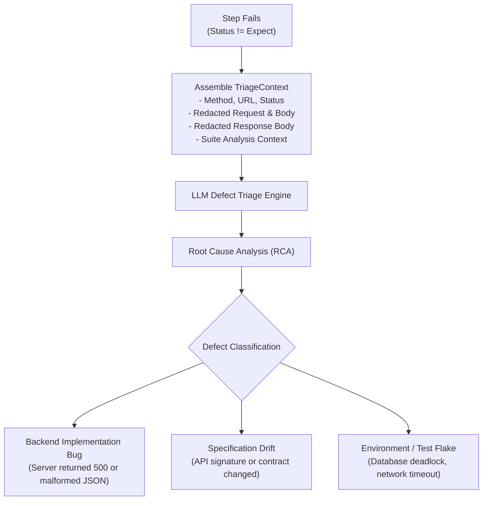

# Test Oracle & AI Defect Triage

API validation in SpecTest couples deterministic verification with an automated **AI Defect Triage** engine when failures occur.

---

## 1. Deterministic Status & Extraction Oracle

Every step in `spectest.yaml` defines an expected HTTP status code (`expect`) and optional variable extractions (`save`):

```yaml
- call: "POST {shop}/api/orders"
  expect: 201
  save:
    order_id: body.id
    etag: header.ETag
```

### Evaluation Criteria:
1. **Status Code Verification**: The returned HTTP status must match `step.Expect` exactly (e.g. `200`, `201`, or `400` for negative tests).
2. **Dynamic Variable Extraction**:
   - `body.<dot-path>`: Navigates nested JSON responses (e.g., `body.items.0.id` extracts the ID from the first element of an items array).
   - `header.<name>`: Extracts HTTP response headers (e.g., `header.Authorization`).
   - If extraction fails (e.g., key does not exist or invalid JSON), the step is marked as failed.

---

## 2. Safety & Data Protection

### 1MB Response Body Limiting
To prevent denial-of-service and out-of-memory errors when testing endpoints that stream or return massive payloads, SpecTest enforces a **1MB upper bound**:

```go
limitedReader := io.LimitReader(resp.Body, maxResponseBodyBytes+1)
```

If a response body exceeds 1,048,576 bytes:
- The runner captures the first 1MB.
- Truncates the remainder and appends `\n[TRUNCATED: response body exceeded 1MB limit]`.
- Memory consumption remains predictable and bounded.

### Automated Sensitive Data Redaction
SpecTest automatically redacts secrets before emitting telemetry, generating reports, or invoking the LLM:

- **Headers**: Authorization tokens, bearer tokens, cookies, and API key headers are masked.
- **Payloads**: Sensitive JSON fields (e.g., `password`, `token`, `secret`, `access_token`, `jwt`) have their values replaced with `[REDACTED]`.
- **URLs**: Userinfo and sensitive query parameters are stripped from logged endpoints.

---

## 3. Automated AI Defect Triage

When an assertion fails during execution with `--triage`, SpecTest captures the context and invokes the configured LLM:



### Triage Analysis Output
The generated triage diagnosis is attached directly to the `ExecutionRecord` and included in:
- The terminal CLI output (under `AI Diagnosis`).
- The interactive HTML report (`reports/report.html`).
- The Web UI Dashboard run drawer.

### Example Diagnosis:
```text
🔍 AI DEFECT TRIAGE:
- Failure: Expected HTTP 201, got HTTP 422 Unprocessable Entity
- Root Cause: Request body was missing required field 'billing_address_id', which was recently added to the OpenAPI contract.
- Classification: Specification Drift
- Recommended Action: Update step payload in spectest.yaml to provide 'billing_address_id' or update schema defaults.
```
