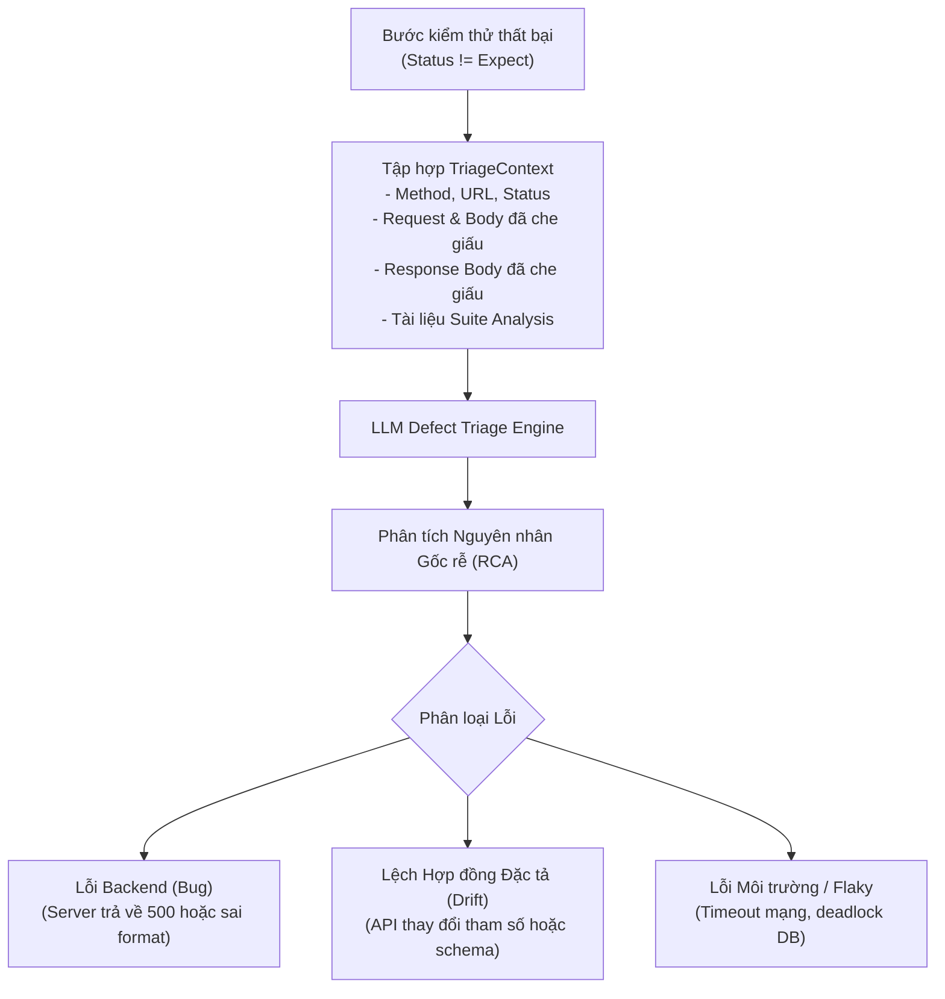

# Kiểm chứng Kết quả & AI Defect Triage

Quy trình xác thực API trong SpecTest kết hợp chặt chẽ giữa việc kiểm chứng tất định và cơ chế **AI Defect Triage** tự động phân tích khi có lỗi phát sinh.

---

## 1. Oracle Kiểm tra Trạng thái & Trích xuất Dữ liệu Tất định

Mỗi bước kiểm thử trong `spectest.yaml` định nghĩa mã trạng thái HTTP kỳ vọng (`expect`) và các quy tắc trích xuất biến tùy chọn (`save`):

```yaml
- call: "POST {shop}/api/orders"
  expect: 201
  save:
    order_id: body.id
    etag: header.ETag
```

### Tiêu chí Đánh giá:
1. **Khớp Mã Trạng thái (HTTP Status)**: Mã HTTP trả về từ server phải khớp tuyệt đối với giá trị `step.Expect` (ví dụ `200`, `201`, hoặc `400` đối với ca kiểm thử tiêu cực).
2. **Trích xuất Biến Động**:
   - `body.<dot-path>`: Truy xuất sâu vào JSON response (ví dụ: `body.items.0.id` trích xuất ID của phần tử đầu tiên trong mảng items).
   - `header.<name>`: Trích xuất giá trị header của response (ví dụ: `header.Authorization`).
   - Nếu trích xuất thất bại (key không tồn tại hoặc response không phải JSON hợp lệ), bước kiểm thử sẽ bị đánh dấu là lỗi.

---

## 2. An toàn Bộ nhớ & Bảo vệ Dữ liệu

### Giới hạn Kích thước Response Body ở mức 1MB
Để tránh việc cạn kiệt RAM và treo tiến trình kiểm thử khi gặp phải các endpoint trả về dữ liệu quá lớn, SpecTest áp dụng trần giới hạn **1MB**:

```go
limitedReader := io.LimitReader(resp.Body, maxResponseBodyBytes+1)
```

Nếu kích thước phản hồi vượt quá 1,048,576 bytes:
- Runner chỉ đọc và lưu giữ 1MB đầu tiên.
- Cắt bỏ phần dư thừa và thêm ghi chú `\n[TRUNCATED: response body exceeded 1MB limit]`.
- Mức tiêu thụ bộ nhớ luôn được kiểm soát trong phạm vi an toàn tuyệt đối.

### Tự động Che giấu Dữ liệu Nhạy cảm (Redaction)
SpecTest tự động làm sạch và che giấu các thông tin bí mật trước khi lưu vào report hoặc gửi prompt cho LLM:

- **Headers**: Các header chứa token ủy quyền, cookie, session id và api key đều bị mask.
- **Payloads**: Các trường JSON nhạy cảm (như `password`, `token`, `secret`, `access_token`, `jwt`) có giá trị được thay thế bằng `[REDACTED]`.
- **URLs**: Thông tin userinfo và các query param nhạy cảm trong đường dẫn URL được loại bỏ trước khi ghi log.

---

## 3. Tự động Chẩn đoán Lỗi bằng AI (AI Defect Triage)

Khi một bước kiểm thử thất bại trong lượt chạy có gắn cờ `--triage`, SpecTest thu thập đầy đủ snapshot ngữ cảnh và gửi đến LLM đã cấu hình:



### Nội dung Kết quả Chẩn đoán
Kết quả triage được đính kèm trực tiếp vào `ExecutionRecord` và hiển thị trên:
- Terminal CLI (dưới mục `AI Diagnosis`).
- Báo cáo HTML dashboard tương tác (`reports/report.html`).
- Giao diện Web UI Runner drawer.

### Ví dụ Chẩn đoán Thực tế:
```text
🔍 AI DEFECT TRIAGE:
- Lỗi: Kỳ vọng HTTP 201, nhưng nhận được HTTP 422 Unprocessable Entity
- Nguyên nhân: Request body thiếu trường bắt buộc 'billing_address_id', trường này mới được thêm vào tài liệu OpenAPI gần đây.
- Phân loại: Specification Drift (Lệch đặc tả)
- Đề xuất khắc phục: Cập nhật payload của bước test trong spectest.yaml để bổ sung 'billing_address_id' hoặc cập nhật giá trị mặc định trong schema.
```
