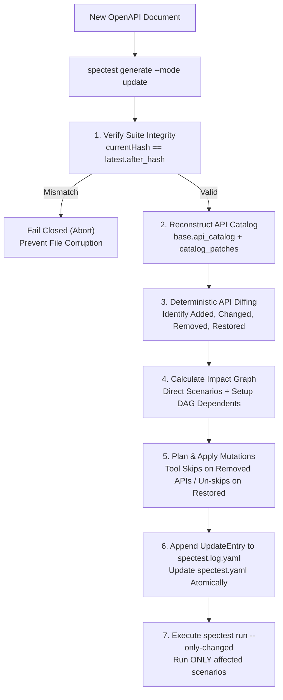

# Spec-Drift & Incremental Update Mode

In modern API lifecycles, backend endpoints constantly evolve: new query parameters are added, endpoints are deprecated, schemas are updated, and breaking changes emerge. Manually updating test suites or re-generating suites from scratch leads to losing custom scenarios, breaking variable links, and incurring unnecessary LLM token costs.

**SpecTest** solves this with **Deterministic Spec-Drift & Incremental Update Mode** (`spectest generate --mode update`), built directly on the **Two-File Architecture** (`spectest.yaml` and `spectest.log.yaml`).

---

## The 2-File Update Workflow



---

## Key Mechanism & Principles

### 1. Zero-Token Deterministic First
The update pipeline performs all catalog reconstructions, diffing, graph impact calculations, and contract validations in pure Go with **0 LLM tokens**. An LLM is invoked only if semantic repair or new scenario creation is explicitly needed.

### 2. Fail-Closed Hash Verification
Before inspecting any file, SpecTest verifies that:
$$\text{SHA-256}(\text{spectest.yaml mutable blocks}) == \text{latest.AfterHash}$$
If `spectest.yaml` has unrecorded manual edits, the update command immediately aborts without touching any files, protecting the integrity of the suite.

### 3. Reconstructing the API Catalog
Rather than storing an external tracking file (`spectest.track.yaml`), SpecTest reconstructs the active API catalog in memory:
1. Starts with `base.api_catalog` from `spectest.log.yaml`.
2. Applies each `UpdateEntry.catalog_patch` in sequential order ($N = 1, 2, 3\dots$).
3. Produces the authoritative map of all known endpoints, signatures, response codes, and active/removed states.

### 4. Deterministic Impact Graph
When an API changes:
- Any scenario directly calling that API is marked as impacted.
- Any `setup` block calling that API is marked as impacted.
- Through the **Setup DAG**, any scenario that depends (directly or transitively via `use: [...]`) on an impacted setup is also included in the impact set.

### 5. Safe Handling of Removed & Restored APIs
- **Removed APIs**: Rather than deleting user-written test cases, SpecTest adds a tool skip annotation:
  ```yaml
  skip: "spectest: API POST {shop}/api/legacy removed"
  ```
  If a scenario is protected with `locked: true` and its underlying API is removed, the update halts with an error to alert the engineering team.
- **Restored APIs**: When an endpoint reappears in a subsequent revision, SpecTest automatically strips only the tool skips matching `spectest: API`, while strictly preserving any custom, human-written skip reasons.

---

## Linking to `spectest run --only-changed`

Every completed update records its impacted setups and scenarios into `UpdateEntry.Impact`:

```yaml
update:
  - n: 2
    impact:
      setups: [product]
      scenarios: [create-order]
```

When you run:
```bash
spectest run --only-changed
```
The test runner inspects this impact block and executes **only** the affected scenarios, delivering instant feedback in CI/CD without re-running unaffected tests.
