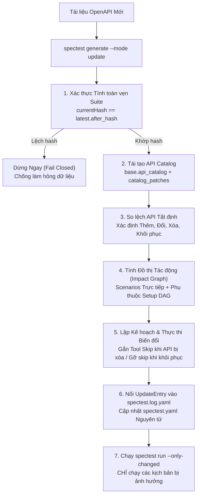

# Lệch Đặc tả & Chế độ Cập nhật Tăng dần

Trong vòng đời phát triển API hiện đại, các endpoint liên tục thay đổi: thêm tham số query mới, đổi cấu trúc body, ngừng hỗ trợ endpoint cũ hoặc phát sinh breaking changes. Việc cập nhật kịch bản kiểm thử thủ công hoặc tạo lại toàn bộ từ đầu sẽ làm mất các kịch bản tùy biến của nhóm phát triển, gãy chuỗi nối biến và gây tốn kém chi phí token LLM không đáng có.

**SpecTest** giải quyết trọn vẹn bài toán này bằng **Chế độ Cập nhật Tăng dần & Xử lý Lệch Đặc tả Tất định** (`spectest generate --mode update`), vận hành trực tiếp trên **Kiến trúc Đúng 2 File** (`spectest.yaml` và `spectest.log.yaml`).

---

## Quy trình Cập nhật trên Mô hình 2 File



---

## Các Cơ chế & Nguyên tắc Cốt lõi

### 1. Tất định Không Tiêu tốn Token (Zero-Token First)
Toàn bộ các bước tái tạo catalog, so lệch API, tính đồ thị tác động và validate hợp đồng diễn ra hoàn toàn bằng Go thuần (**0 token LLM**). LLM chỉ được kích hoạt khi có nhu cầu sửa đổi logic kịch bản phức tạp hoặc viết kịch bản nghiệp vụ mới.

### 2. Kiểm chứng Hash Ngắt Lỗi (Fail-Closed)
Trước khi chạm vào bất kỳ file nào, SpecTest kiểm tra:
$$\text{SHA-256}(\text{4 khối mutable của spectest.yaml}) == \text{latest.AfterHash}$$
Nếu `spectest.yaml` có các chỉnh sửa thủ công chưa được ghi nhận trong log, lệnh cập nhật sẽ dừng lại ngay lập tức mà không sửa đổi file nào.

### 3. Tái tạo API Catalog từ Lịch sử
Thay vì duy trì một file tracking riêng rẽ (`spectest.track.yaml`), SpecTest tái tạo catalog API ngay trong bộ nhớ:
1. Bắt đầu từ `base.api_catalog` lưu trong `spectest.log.yaml`.
2. Áp dụng tuần tự các bản vá `UpdateEntry.catalog_patch` ($N = 1, 2, 3\dots$).
3. Thu được bức tranh chuẩn xác về mọi endpoint, chữ ký request, mã response và trạng thái active/removed.

### 4. Đồ thị Tác động Tất định
Khi một API thay đổi:
- Kịch bản nào gọi trực tiếp API đó sẽ được đánh dấu là bị tác động.
- Khối `setup` nào gọi API đó sẽ được đánh dấu là bị tác động.
- Thông qua **Setup DAG**, bất kỳ scenario nào phụ thuộc (trực tiếp hoặc gián tiếp qua `use: [...]`) vào khối setup đó cũng sẽ được đưa vào danh sách tác động.

### 5. Xử lý An toàn cho API Bị Xóa & Được Khôi phục
- **API bị Xóa**: Thay vì tự ý xóa bỏ kịch bản của người dùng, SpecTest tự động gắn chú thích skip:
  ```yaml
  skip: "spectest: API POST {shop}/api/legacy removed"
  ```
  Nếu một kịch bản đang được bảo vệ với cờ `locked: true` mà API của nó bị xóa, lệnh update sẽ báo lỗi dừng lại để cảnh báo đội ngũ kỹ sư.
- **API được Khôi phục**: Khi một endpoint xuất hiện trở lại, SpecTest tự động gỡ bỏ đúng các skip do công cụ sinh ra (`spectest: API`), đồng thời giữ nguyên vẹn mọi lý do skip tùy biến do con người tự viết.

---

## Kết nối Trực tiếp với `spectest run --only-changed`

Mỗi lần cập nhật thành công sẽ lưu danh sách các setup và scenario bị ảnh hưởng vào `UpdateEntry.Impact`:

```yaml
update:
  - n: 2
    impact:
      setups: [product]
      scenarios: [create-order]
```

Khi bạn chạy:
```bash
spectest run --only-changed
```
Test runner sẽ đọc khối impact này và **chỉ thực thi đúng các kịch bản bị ảnh hưởng**, mang lại phản hồi kiểm thử siêu tốc trong CI/CD mà không phải chạy lại toàn bộ test suite lớn.
