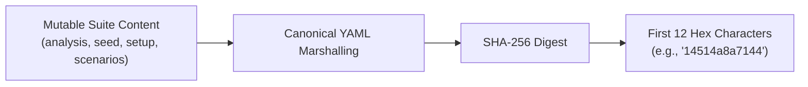

# Two-Artifact Architecture

Rather than fragmenting test logic across scattered Postman collections, `.env` files, custom bash scripts, and test runner configurations, **SpecTest** operates around exactly **two canonical artifacts**:

```text
tests/
├── spectest.yaml      # The active, executable test suite specification (Schema v1)
└── spectest.log.yaml  # The append-only audit history with cryptographic suite hashes
```

---

## 1. `spectest.yaml` (The Active Suite)

`spectest.yaml` defines the current state of an API test suite using schema version `1`:

- **`servers`**: Registered server aliases (e.g. `[shop, billing]`).
- **`apis`**: List of covered API operations (e.g. `["POST {shop}/api/login", "GET {shop}/api/products"]`).
- **`analysis`**: Markdown documentation explaining business rationale and testing strategy.
- **`seed`**: Global environment variables shared across all scenarios.
- **`setup`**: Reusable pre-execution blocks that prepare dependencies (e.g. create authenticated session, provision test tenant).
- **`scenarios`**: Ordered, executable business workflows with stable kebab-case IDs.

### Mutable vs. Derived Content
In `spectest.yaml`, `version`, `servers`, and `apis` are derived from input specs. The remaining four blocks constitute the **Mutable Suite Content**:
- `analysis`
- `seed`
- `setup`
- `scenarios`

Any user edit or AI-driven update modifies these mutable blocks.

---

## 2. `spectest.log.yaml` (The Append-Only History)

`spectest.log.yaml` maintains a tamper-evident, append-only history of the test suite. It records:
- **`base`**: Snapshot of the initially generated suite, timestamp, author (`ai` or `user`), and starting hash.
- **`update`**: Array of incremental change records (`n: 1`, `n: 2`, ...):
  - `at` & `by`: Timestamp and author (`ai` or `user`).
  - `note`: Human-readable summary of what changed.
  - `trigger`: Details on what caused the change (OpenAPI endpoints added/changed/removed, or PRD hash diff).
  - `impact`: Target scenarios and setups directly affected by this update.
  - `create`: New seed variables, setups, or scenarios introduced by this entry.
  - `change`: Field-level mutations (`target`, `id`, `reason`, `before`, `after`).
  - `after_hash`: The suite hash immediately after applying this update.

---

## Cryptographic Suite Hashing

To ensure that `spectest.yaml` and `spectest.log.yaml` remain perfectly synchronized and to prevent undetected manual edits or stale test runs, SpecTest computes a canonical hash:



1. Takes the four mutable blocks: `analysis`, `seed`, `setup`, and `scenarios`.
2. Serializes them deterministically.
3. Computes the SHA-256 checksum.
4. Uses the **first 12 hexadecimal characters** as the canonical suite hash (e.g. `14514a8a7144`).

### Verification during `--only-changed`
When running `spectest run --only-changed`:
1. The runner reads `spectest.log.yaml` and finds the latest update entry `latest`.
2. It re-hashes the current `spectest.yaml`.
3. If `currentHash != latest.AfterHash`, the runner **aborts immediately**, warning the user that `spectest.yaml` has been manually modified or the log file is out of sync.

---

## Deprecation of Legacy 3-File Model

Earlier versions of SpecTest utilized an experimental three-file structure including `spectest.track.yaml`. 
The canonical architecture now standardizes strictly on **`spectest.yaml`** and **`spectest.log.yaml`**. All tracking metadata, catalog state, and change triggers are unified directly within `spectest.log.yaml`.
