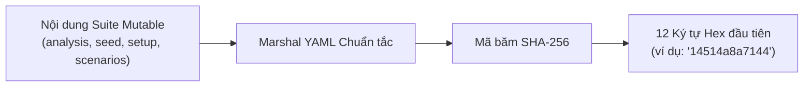

# Kiến trúc Hai Artifact

Thay vì phân mảnh dữ liệu kiểm thử ra hàng loạt file JSON của Postman, file biến môi trường `.env`, script bash tùy biến và plugin bên thứ ba, **SpecTest** vận hành xung quanh đúng **hai artifact chuẩn mực**:

```text
tests/
├── spectest.yaml      # File đặc tả kịch bản kiểm thử đang hoạt động (Schema v1)
└── spectest.log.yaml  # Lịch sử kiểm toán ghi nối tiếp kèm mã băm mật mã
```

---

## 1. `spectest.yaml` (Suite đang hoạt động)

`spectest.yaml` định nghĩa trạng thái hiện tại của bộ kiểm thử API theo schema version `1`:

- **`servers`**: Danh sách alias máy chủ đã đăng ký (ví dụ `[shop, billing]`).
- **`apis`**: Danh sách các API operation được bao phủ (ví dụ `["POST {shop}/api/login", "GET {shop}/api/products"]`).
- **`analysis`**: Tài liệu Markdown giải thích cơ sở nghiệp vụ và chiến lược kiểm thử.
- **`seed`**: Các biến môi trường toàn cục dùng chung cho toàn bộ scenario.
- **`setup`**: Các khối chuẩn bị dữ liệu tái sử dụng (ví dụ: tạo phiên đăng nhập, seed dữ liệu người dùng mẫu).
- **`scenarios`**: Danh sách kịch bản nghiệp vụ thực thi có ID dạng kebab-case ổn định.

### Nội dung Mutable vs. Derived
Trong `spectest.yaml`, ba trường `version`, `servers` và `apis` được suy ra trực tiếp từ các file đặc tả đầu vào. Bốn khối còn lại tạo thành **Nội dung Có thể Thay đổi (Mutable Suite Content)**:
- `analysis`
- `seed`
- `setup`
- `scenarios`

Mọi chỉnh sửa của người dùng hoặc cập nhật tự động từ AI đều tác động lên 4 khối mutable này.

---

## 2. `spectest.log.yaml` (Lịch sử Ghi nối tiếp)

`spectest.log.yaml` duy trì một lịch sử ghi nối tiếp (append-only) không thể giả mạo. File này ghi nhận:
- **`base`**: Snapshot của bộ test được sinh lần đầu tiên, thời điểm tạo, tác giả (`ai` hoặc `user`) và mã băm khởi đầu.
- **`update`**: Mảng các bản ghi thay đổi tăng dần (`n: 1`, `n: 2`, ...):
  - `at` & `by`: Dấu thời gian và tác giả (`ai` hoặc `user`).
  - `note`: Ghi chú tóm tắt nội dung thay đổi bằng ngôn ngữ tự nhiên.
  - `trigger`: Chi tiết nguyên nhân dẫn đến thay đổi (endpoints OpenAPI được thêm/sửa/xóa, hoặc mã băm PRD thay đổi).
  - `impact`: Danh sách các scenario và setup bị ảnh hưởng trực tiếp (phục vụ cờ `--only-changed`).
  - `create`: Các biến seed, setup hoặc scenario mới được bổ sung.
  - `change`: Chi tiết thay đổi ở cấp độ trường (`target`, `id`, `reason`, `before`, `after`).
  - `after_hash`: Mã băm của suite ngay sau khi áp dụng bản cập nhật này.

---

## Thuật toán Băm Suite bằng Mật mã (Suite Hash)

Để đảm bảo `spectest.yaml` và `spectest.log.yaml` luôn đồng bộ và ngăn chặn việc can thiệp chỉnh sửa thủ công không được ghi nhận, SpecTest tính toán mã băm chuẩn tắc:



1. Trích xuất 4 khối mutable: `analysis`, `seed`, `setup`, và `scenarios`.
2. Tuần tự hóa theo chuẩn YAML tất định.
3. Tính mã băm SHA-256.
4. Lấy **12 ký tự thập lục phân đầu tiên** làm mã băm chuẩn tắc của suite (ví dụ `14514a8a7144`).

### Kiểm chứng khi chạy `--only-changed`
Khi bạn chạy lệnh `spectest run --only-changed`:
1. Runner đọc `spectest.log.yaml` và tìm bản ghi update mới nhất `latest`.
2. Runner tính toán lại mã băm của `spectest.yaml` hiện tại.
3. Nếu `currentHash != latest.AfterHash`, runner sẽ **dừng lại ngay lập tức** và cảnh báo rằng `spectest.yaml` đã bị sửa đổi thủ công hoặc file log đang bị lệch so với suite.

---

## Loại bỏ Mô hình 3-File Cũ

Các phiên bản thử nghiệm trước đây của SpecTest từng dùng mô hình 3 file với sự xuất hiện của `spectest.track.yaml`. 
Hiện nay, kiến trúc chuẩn tắc đã quy về duy nhất **`spectest.yaml`** và **`spectest.log.yaml`**. Toàn bộ siêu dữ liệu theo dõi, catalog trạng thái API và trigger thay đổi được tích hợp trực tiếp vào `spectest.log.yaml`.
