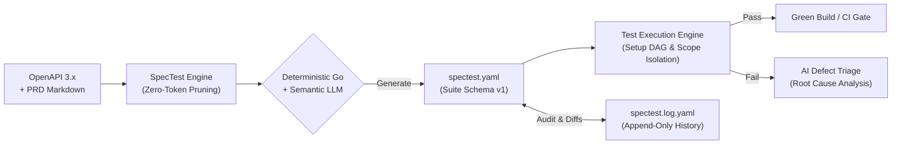

# SpecTest

  
<strong>Autonomous AI Test Engineering Engine & GitHub Action</strong>

  
<em>Turn OpenAPI 3.x specifications and Markdown requirements into production-grade executable API test suites with isolated scenario state, setup dependency resolution, and automated LLM defect triage.</em>

---

## Overview

**SpecTest** is an open-source, cost-efficient API test engineering engine designed for modern API lifecycles. It converts OpenAPI specifications and product requirement documents (PRD Markdown) into robust, repeatable API test suites.

Packaged as a single Go binary, the core engine runs across **CLI**, an **embedded Web UI**, and **CI/CD quality gates (GitHub Actions)**. It operates around an explicit **Two-Artifact Model**:
1. **`spectest.yaml`**: The active, human-editable test suite contract (version 1).
2. **`spectest.log.yaml`**: The append-only audit history capturing initial baselines, subsequent updates, and cryptographic suite hashes.

---

## Core Pillars

=== "Zero-Token First"
    Save **85% to 92%** of LLM operational costs. Spec compression, authentication token wiring, setup dependency DAG resolution, status code evaluation, response value extraction, and API catalog diffing run in pure Go with **0 LLM tokens**. LLMs are called only where semantic reasoning is needed: designing business journeys, diagnosing failed runs, and repairing steps affected by API changes.

=== "Two-Artifact Architecture"
    No fragmented configuration. The entire lifecycle is captured in two files:
    - `spectest.yaml`: Contains `servers`, `apis`, `analysis`, global `seed` variables, reusable `setup` blocks, and executable `scenarios`.
    - `spectest.log.yaml`: An append-only audit trail tracking every mutation with a canonical 12-character SHA-256 suite hash.

=== "Setup DAG & Isolated Scopes"
    Every scenario runs inside an **isolated runtime scope** seeded from global defaults. Reusable `setup` blocks resolve dependencies automatically via a **Directed Acyclic Graph (DAG)** with topological sorting and cycle detection. If a setup fails, the runner fails fast for that scenario while allowing independent scenarios to continue.

=== "Multi-Target & Dynamic Aliases"
    Supports microservices and complex environments through server aliases (e.g. `POST {shop}/api/login` and `GET {billing}/invoices`). Targets can be mapped via CLI flags (`-t shop=http://localhost:8001 -t billing=http://localhost:8002`) or a single default URL.

=== "Automated Docker Compose Lifecycle"
    Bring up entire dependency stacks (databases, Redis, mock servers) with `--compose`. SpecTest automatically boots services, polls healthcheck endpoints until ready, runs the test suite, and guarantees teardown via `defer` hooks even on `Ctrl-C` (`SIGINT`).

=== "AI Defect Triage"
    When an API test step fails, the optional `--triage` flag captures sanitized request/response snapshots and invokes the LLM to perform Root Cause Analysis (RCA), identifying whether the failure is a backend bug, contract drift, or test flakiness.

---

## Supported Ecosystem

| Platform | Deployment Modes | Key Benefits |
| :--- | :--- | :--- |
| **Local Development** | Single static Go binary (`spectest`) | Instant generation, fast local execution, multi-target mapping, and shell scripting. |
| **Interactive Dashboard** | `spectest ui` (Built-in React Web UI) | Workspace file manager, visual spec inspector, real-time SSE execution runner, and history diff viewer. |
| **CI/CD Quality Gates** | GitHub Actions (`action.yml`) | Zero-install composite action publishing JUnit XML and HTML test reports. |
| **On-Premise / Air-Gapped** | Ollama / vLLM local endpoints | Run completely offline without leaking proprietary API specs or tokens to public clouds. |

---

## Quick Navigation

-   :material-rocket-launch: __[Quick Start Guide](quickstart.md)__

    ---

    Install SpecTest and execute your first automated test suite in under 3 minutes.

-   :material-console: __[CLI Reference](cli/overview.md)__

    ---

    Complete manual of commands: `generate`, `run`, `config`, and `ui` with flag references and examples.

-   :material-file-document-outline: __[Suite Specification](configuration/suite-spec.md)__

    ---

    Deep dive into `spectest.yaml` (v1 schema), setup DAGs, variable interpolation, and `save` extractions.

-   :material-history: __[History Log Specification](configuration/history-log-spec.md)__

    ---

    Learn how `spectest.log.yaml` tracks changes, triggers, impact analysis, and canonical SHA-256 hashing.

-   :material-cog: __[Execution Lifecycle](concepts/execution-lifecycle.md)__

    ---

    Detailed 9-step execution pipeline, target resolution, response truncation, and scope isolation.

-   :material-github: __[CI/CD Integration](integrations/github-actions.md)__

    ---

    Automate API regression tests in GitHub Actions workflows with native reports.

