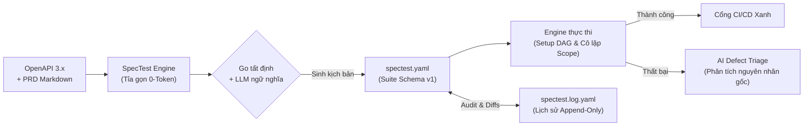

# SpecTest

  
<strong>Công cụ Kỹ nghệ Kiểm thử API Tự trị bằng AI & GitHub Action</strong>

  
<em>Chuyển đổi đặc tả OpenAPI 3.x và tài liệu yêu cầu Markdown thành bộ kịch bản kiểm thử API hoàn chỉnh, cô lập trạng thái từng kịch bản, tự động phân giải phụ thuộc setup qua DAG và chẩn đoán lỗi bằng AI.</em>

---

## Tổng quan

**SpecTest** là công cụ mã nguồn mở kiểm thử API hiện đại theo triết lý tối ưu chi phí. SpecTest chuyển đổi các tài liệu đặc tả OpenAPI và yêu cầu nghiệp vụ (PRD Markdown) thành bộ kiểm thử API thực thi được, chính xác và có tính lặp lại cao.

Được đóng gói thành một file nhị phân Go duy nhất, engine cốt lõi hoạt động thống nhất trên cả **CLI**, giao diện **Web UI tích hợp**, và **GitHub Actions CI/CD**. Toàn bộ hệ thống vận hành xoay quanh **Mô hình đúng 2 Artifact**:
1. **`spectest.yaml`**: Bản đặc tả kịch bản kiểm thử đang hoạt động (Schema version 1).
2. **`spectest.log.yaml`**: Lịch sử kiểm toán ghi nối tiếp (append-only) lưu trữ snapshot gốc, các bản cập nhật và mã băm mật mã của suite.

---

## Các trụ cột cốt lõi

=== "Zero-Token First"
    Tiết kiệm **85% đến 92%** chi phí LLM. Việc nén spec, liên kết auth token, giải thuật phân giải phụ thuộc DAG, kiểm tra mã HTTP status, trích xuất dữ liệu response và so khớp catalog API được thực hiện hoàn toàn bằng thuật toán Go thuần (**0 token LLM**). LLM chỉ được gọi khi thực sự cần tư duy ngữ nghĩa: thiết kế luồng nghiệp vụ, phân tích ca lỗi và sửa đổi kịch bản khi API thay đổi.

=== "Kiến trúc 2 Artifact"
    Không phân mảnh cấu hình. Toàn bộ vòng đời gói gọn trong đúng 2 file:
    - `spectest.yaml`: Chứa `servers`, `apis`, `analysis`, biến toàn cục `seed`, các khối `setup` tái sử dụng và danh sách `scenarios`.
    - `spectest.log.yaml`: Lịch sử kiểm toán ghi nối tiếp, theo dõi từng thay đổi bằng mã băm SHA-256 12 ký tự chuẩn tắc.

=== "Setup DAG & Cô lập Scope"
    Mỗi scenario chạy trong một **runtime scope độc lập**, kế thừa từ `seed` toàn cục. Các khối `setup` được phân giải phụ thuộc tự động qua **Đồ thị có hướng không chu trình (DAG)** với thuật toán sắp xếp tô-pô và phát hiện vòng lặp. Nếu một setup thất bại, runner chỉ fail scenario đó mà không làm ảnh hưởng đến các scenario độc lập khác.

=== "Đa Target & Alias Động"
    Hỗ trợ kiểm thử kiến trúc microservices thông qua alias máy chủ (ví dụ `POST {shop}/api/login` và `GET {billing}/invoices`). Target được ánh xạ linh hoạt qua cờ dòng lệnh (`-t shop=http://localhost:8001 -t billing=http://localhost:8002`) hoặc dùng target mặc định.

=== "Tự động quản lý vòng đời Docker Compose"
    Tự động khởi động toàn bộ hạ tầng phụ thuộc (database, Redis, mock server) với cờ `--compose`. SpecTest tự động chạy `docker compose up -d`, thăm dò healthcheck cho đến khi sẵn sàng, chạy test suite và đảm bảo dọn dẹp bằng `defer` ngay cả khi bấm `Ctrl-C` (`SIGINT`).

=== "AI Defect Triage"
    Khi một bước kiểm thử API thất bại, cờ `--triage` sẽ chụp lại snapshot request/response đã che giấu thông tin nhạy cảm và kích hoạt LLM để phân tích nguyên nhân gốc rễ (RCA), phân loại lỗi do backend bug, lệch đặc tả (contract drift) hay lỗi môi trường.

---

## Hệ sinh thái hỗ trợ

| Nền tảng | Chế độ triển khai | Lợi ích chính |
| :--- | :--- | :--- |
| **Local Development** | 1 file binary Go duy nhất (`spectest`) | Sinh kịch bản tức thì, chạy kiểm thử cực nhanh, hỗ trợ ánh xạ multi-target và dễ viết script. |
| **Giao diện Web UI** | `spectest ui` (Giao diện React tích hợp) | Quản lý workspace, xem trực quan đặc tả, streaming kết quả thời gian thực qua SSE và so sánh lịch sử diff. |
| **CI/CD Quality Gate** | GitHub Actions (`action.yml`) | Composite action cài đặt 0 giây, tự động xuất báo cáo JUnit XML và HTML dashboard. |
| **On-Premise / Air-Gapped** | Endpoint Ollama / vLLM cục bộ | Chạy offline 100%, bảo mật tuyệt đối không gửi đặc tả API nội bộ ra cloud. |

---

## Điều hướng nhanh

-   :material-rocket-launch: __[Hướng dẫn Khởi động Nhanh](quickstart.vi.md)__

    ---

    Cài đặt SpecTest và chạy bộ kiểm thử đầu tiên trong chưa đầy 3 phút.

-   :material-console: __[Tra cứu Lệnh CLI](cli/overview.vi.md)__

    ---

    Cẩm nang đầy đủ các lệnh: `generate`, `run`, `config`, và `ui` kèm bảng cờ chi tiết và ví dụ.

-   :material-file-document-outline: __[Đặc tả Suite spectest.yaml](configuration/suite-spec.vi.md)__

    ---

    Chi tiết về cấu trúc `spectest.yaml` (schema v1), DAG setup, nội suy biến và trích xuất `save`.

-   :material-history: __[Đặc tả Lịch sử spectest.log.yaml](configuration/history-log-spec.vi.md)__

    ---

    Tìm hiểu cách `spectest.log.yaml` lưu vết cập nhật, triggers, phân tích tác động và mã băm SHA-256.

-   :material-cog: __[Vòng đời Thực thi](concepts/execution-lifecycle.vi.md)__

    ---

    Chi tiết pipeline 9 bước thực thi HTTP, phân giải target, giới hạn response 1MB và cô lập scope.

-   :material-github: __[Tích hợp CI/CD](integrations/github-actions.vi.md)__

    ---

    Tự động hóa kiểm thử hồi quy API trong GitHub Actions workflow kèm báo cáo chi tiết.

