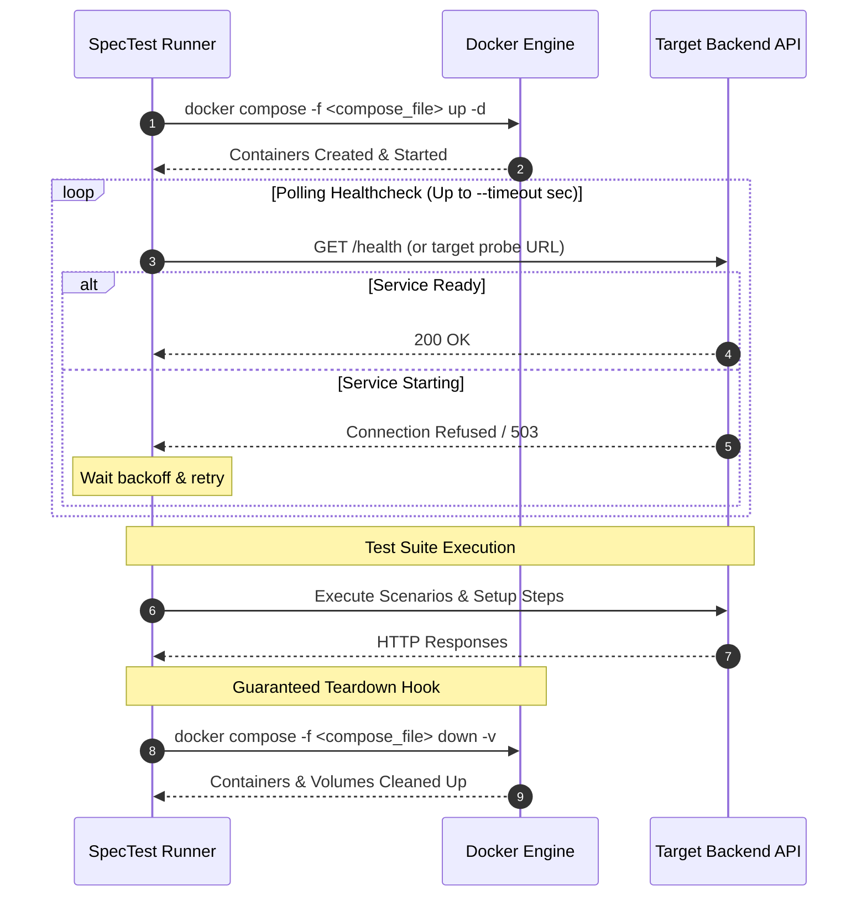

# Docker & Compose Lifecycle

Testing microservices or API backends typically requires a cluster of dependencies: databases (PostgreSQL, MySQL), cache stores (Redis), message queues, and mock servers. Managing these dependencies manually in local environments or CI/CD pipelines often results in stale containers, port collisions, and flaky tests.

**SpecTest** provides built-in, native orchestration of Docker Compose lifecycles directly within the test execution runner (`spectest run --compose`).

---

## How It Works



---

## Execution Command

Pass the path to your Docker Compose file via `--compose`:

```bash
spectest run \
  -f tests/spectest.yaml \
  --compose docker-compose.test.yml \
  -t http://localhost:8080 \
  --timeout 45
```

---

## Guaranteed Teardown Safety

In automated CI/CD runners, tests that encounter panics, failures, or cancellation signals (`SIGINT` / `SIGTERM`) frequently leave orphaned containers consuming CPU and memory.

SpecTest guarantees container cleanup through Go's native deferred execution and OS signal listening:

- **Signal Interception**: If an operator cancels the run with `Ctrl-C` (`SIGINT`), SpecTest intercepts the signal, immediately initiates `docker compose down -v`, and waits for the Docker engine to release bound ports.
- **Panic Protection**: Lifecycle cleanup hooks are registered via Go `defer` blocks, ensuring teardown executes even in the event of an unhandled runtime error.
- **Volume Pruning (`-v`)**: Cleans ephemeral databases and test volumes to prevent state contamination between consecutive test runs.
