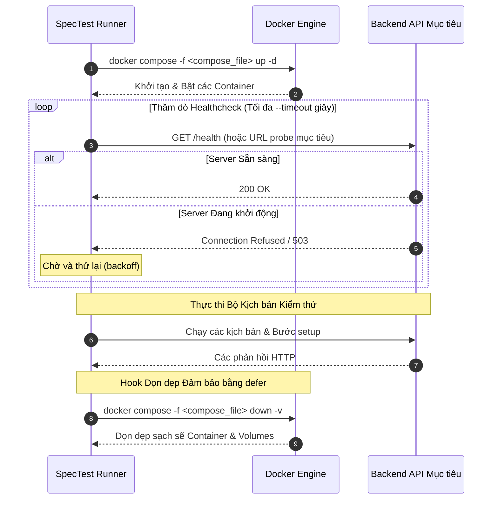

# Vòng đời Docker & Docker Compose

Kiểm thử microservice hoặc backend API thường đòi hỏi một cụm các dịch vụ phụ thuộc: database (PostgreSQL, MySQL), cache (Redis), message queues và mock servers. Việc quản lý các container này thủ công trên máy dev hoặc trong CI/CD pipeline rất dễ dẫn đến tình trạng sót container chạy ngầm, xung đột cổng mạng (port conflict) và test bị chập chờn (flaky).

**SpecTest** tích hợp sẵn cơ chế tự động điều phối toàn bộ vòng đời Docker Compose ngay trong lệnh thực thi (`spectest run --compose`).

---

## Cơ chế Vận hành



---

## Cú pháp Thực thi

Truyền đường dẫn tới file Docker Compose qua cờ `--compose`:

```bash
spectest run \
  -f tests/spectest.yaml \
  --compose docker-compose.test.yml \
  -t http://localhost:8080 \
  --timeout 45
```

---

## Bảo đảm Dọn dẹp An toàn Tuyệt đối

Trong các runner CI/CD tự động, việc test bị panic, fail giữa chừng hoặc người dùng hủy lệnh (`SIGINT` / `SIGTERM`) thường để lại các container chạy ngầm gây chiếm dụng tài nguyên CPU/RAM.

SpecTest bảo đảm việc dọn dẹp container bằng cơ chế `defer` của Go và lắng nghe tín hiệu OS:

- **Bắt Tín hiệu OS**: Nếu người dùng bấm `Ctrl-C` (`SIGINT`), SpecTest bắt tín hiệu, lập tức thực thi `docker compose down -v` và đợi Docker giải phóng các cổng mạng trước khi thoát.
- **Bảo vệ khi Gặp Panic**: Các hook dọn dẹp được đăng ký trong khối `defer`, đảm bảo teardown luôn được gọi kể cả khi xảy ra lỗi runtime nghiêm trọng.
- **Dọn dẹp Volume (`-v`)**: Tự động xóa các volume dữ liệu tạm để tránh việc rò rỉ hoặc lưu dữ liệu bẩn giữa các lượt chạy liên tiếp.
