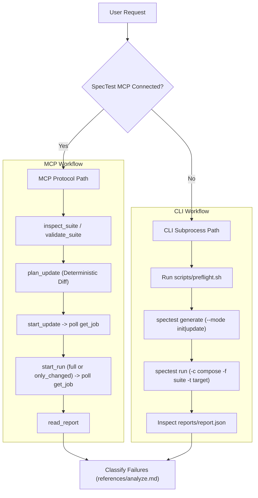

# SpecTest

This skill coordinates the complete SpecTest lifecycle: **Prepare → Generate → Run → Analyze**. This document provides the overarching workflow, safety guardrails, and dual-path execution rules. Detailed procedures reside in `references/`; read only the reference file relevant to your active phase to optimize context.

| Phase | When to Use | Reference File |
| :--- | :--- | :--- |
| **Prepare** | Missing OpenAPI, server alias/URL mapping, or isolated Compose file | [`references/prepare.md`](references/prepare.md) |
| **Generate** | Creating a new suite (`init`) or incrementally syncing specs (`update`) | [`references/generate.md`](references/generate.md) |
| **Run** | Executing test suites (`full` or `--only-changed`) against target environments | [`references/run.md`](references/run.md) |
| **Analyze** | Triaging and classifying test failures based on evidence | [`references/analyze.md`](references/analyze.md) |
| **MCP Reference** | Direct tool schemas and parameters when connected to SpecTest MCP server | [`references/mcp.md`](references/mcp.md) |

Users may request assistance with a single phase (e.g., "why did the test fail?"). Identify where they are in the workflow and transition directly to that phase without forcing them through preceding steps.

---

## Dual-Path Execution Model

SpecTest supports two execution paths:
1. **MCP Tools (Preferred):** Used when the SpecTest Model Context Protocol server is connected to your agent environment (`inspect_suite`, `validate_suite`, `plan_update`, `start_update`, `start_run`, `get_job`, `cancel_job`, `read_report`).
2. **CLI Commands (Fallback):** Used when running directly in shell environments (`spectest generate`, `spectest run`).



---

## Preflight Verification Before Execution

Run `scripts/preflight.sh <init|update|run> [workspace_dir]` before every generation or execution step when using the CLI. The script:
1. Verifies that the `spectest` binary exists in `PATH` and cross-references actual CLI flags against `--help`.
2. Validates the existence of required suite and audit log files.
3. Parses `./.spectest/config.yaml` (or custom workspace config) to verify OpenAPI paths and runtime base URLs.
4. Performs heuristic security scanning on the target Docker Compose file to detect dangerous patterns (external mounts, persistent database volume binds, production domains).

> **Important:** If `scripts/preflight.sh` reports missing flags compared to documentation, **always trust the installed CLI's `--help` output**, as the skill documentation may precede or lag installed versions.

---

## Strict Safety Invariants

These rules exist because `spectest run` (and MCP `start_run`) can purge volumes upon teardown, and test suites generated from fabricated data produce meaningless results:

1. **Never Fabricate Input Data:** Never write fake OpenAPI specifications, guess endpoints, fabricate URLs, or guess environment variables. If information is missing, survey the codebase first, then ask the user.
2. **Strict Test Environment Isolation:** Never run Compose configurations pointing to development or production databases, shared persistent host volumes, or live credentials. If environment isolation cannot be proven, halt and ask the user.
3. **Explicit User Intent for Execution:** Preparing configurations and generating test suites does not grant permission to execute test runs. Only trigger `spectest run` when the user explicitly requests it.
4. **Mandatory CLI Flags:** Always pass `--output` for `spectest generate`. Always pass both `-c` and `-f` explicitly for `spectest run`.
5. **Update Requires Both Suite Files:** Incremental update requires both `spectest.yaml` and `spectest.log.yaml`. If either file is missing, halt and ask the user to run `init` instead.
6. **AI Triage Disabled by Default:** `--triage` (and MCP `triage: true`) must remain disabled by default to prevent unnecessary token consumption. Only enable it when the user explicitly requests AI triage AND an LLM provider is configured.
7. **Never Claim Results Without Inspection:** Never claim a generation succeeded, a test run passed, or a triage diagnosis was completed without reading and parsing the actual output or report file.
8. **Preserve Application Code & Configurations:** Never modify application source code, business requirements, or generated test suites outside supported CLI/MCP flows unless explicitly instructed by the user.
9. **Zero Secret Leakage:** Never log or summarize API keys, Authorization headers, Bearer tokens, passwords, or cookies in chat or summary outputs.

---

## Workspace Structure

Files managed by the agent or SpecTest are placed by convention in `./.spectest/` (or the project's `./tests/` directory):

```text
.spectest/
  config.yaml               # Skill convention to store verified aliases, paths, and URLs
  docker-compose.test.yml   # Isolated test Compose environment
  spectest.yaml             # Executable test suite
  spectest.log.yaml         # Cryptographic append-only audit log
  reports/                  # Generated test and triage reports
```

*Note:* `config.yaml` is a convention used by this skill to remember confirmed server aliases, OpenAPI paths, and runtime URLs across interactions. Do not represent to the user that the SpecTest CLI automatically creates or reads this file. Never copy or relocate source OpenAPI files without user consent.

---

## Communication Protocol

- **Targeted Clarifications:** When critical information is missing, survey the repository first to minimize the number of questions. Ask short, focused questions.
- **Destructive Operation Warnings:** Before any action that could overwrite files, purge volumes, or alter environment configurations, clearly explain the scope and obtain user confirmation.
- **Explain Blockers:** If a step cannot proceed, explicitly state what prerequisite is missing.
- **Lead with Conclusions:** When presenting results, lead with a concise executive summary (status, scenario counts, duration), followed by categorized details. Clearly distinguish between `[CONFIRMED]`, `[PROBABLE]`, and `[UNKNOWN / NEEDS INFO]`.
