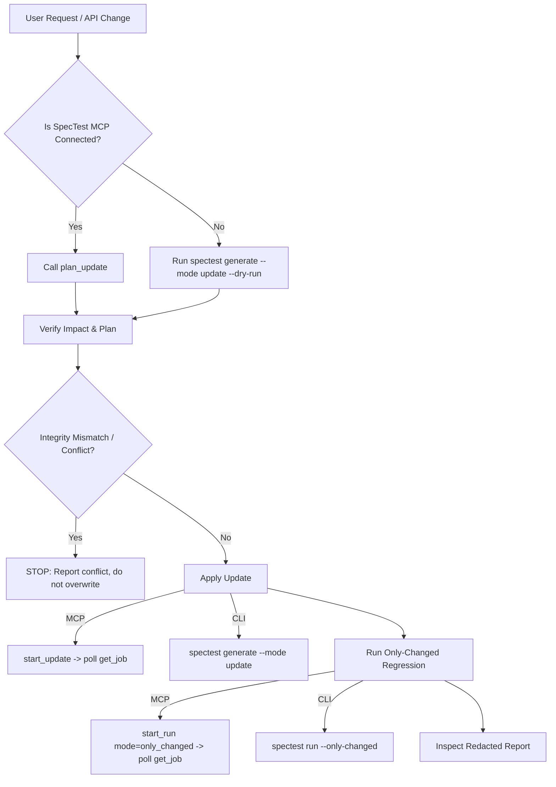

# SpecTest-AI Agent Skill

SpecTest-AI converts OpenAPI 3.x specifications into executable API test suites with isolated scenario scopes, setup DAG dependency resolution, response value extraction, and targeted regression execution.

This skill equips the agent to safely inspect, plan, update, and run test suites using either native **MCP tools** (preferred) or **CLI commands** (fallback).

---

## 1. Capabilities & Dual-Path Routing

Check whether SpecTest MCP tools are connected in your environment:
- **MCP Available:** `plan_update`, `start_update`, `start_run`, `get_job`, `inspect_suite`, `validate_suite`, `read_report`.
- **MCP Unavailable:** Fall back to `spectest` CLI commands directly.



---

## 2. Core Workflow

### Step 1: Inspect Suite State
Before modifying any files:
- **MCP:** Call `inspect_suite` with `{"suite_path": "tests/spectest.yaml"}`.
- **CLI:** Run `spectest mcp` or check `tests/spectest.yaml` and `tests/spectest.log.yaml`.
- Ensure `integrity_match` is true. If hash mismatch occurs, **STOP** immediately.

### Step 2: Plan Update (Deterministic Preview)
Preview what will change before mutating any files or calling LLMs:
- **MCP:** Call `plan_update`:
  ```json
  {
    "output_dir": "tests",
    "apis": [{"server": "auth", "path": "openapi.yaml"}]
  }
  ```
- **CLI:** Run `spectest generate --mode update --api auth=openapi.yaml --file tests/spectest.yaml --dry-run`.
- Review the diff:
  - `added`: New endpoints discovered.
  - `removed`: Deprecated endpoints. Tool skips (`spectest: API ... removed`) will be applied.
  - `changed`: Modifying contracts; repairs will be planned.
  - `restored`: Previously removed endpoints will be un-skipped.

### Step 3: Apply Update
- **MCP:** Call `start_update` with the verified arguments. Poll `get_job` until `status == "succeeded"`.
- **CLI:** Run `spectest generate --mode update --api auth=openapi.yaml --file tests/spectest.yaml`.

### Step 4: Run Targeted Regression (`only_changed`)
Never run a blind full suite when only specific endpoints changed:
- **MCP:** Call `start_run`:
  ```json
  {
    "suite_path": "tests/spectest.yaml",
    "mode": "only_changed",
    "targets": {"auth": "http://127.0.0.1:8000"},
    "compose_file": "docker-compose.yml"
  }
  ```
  Poll `get_job` until finished.
- **CLI:** Run:
  `spectest run --file tests/spectest.yaml --target auth=http://127.0.0.1:8000 --compose docker-compose.yml --only-changed`

### Step 5: Read Redacted Results
- **MCP:** Call `read_report` with `{"report_path": "reports/report.json"}`.
- **CLI:** Inspect `reports/report.json`.
- Summarize scenario outcomes, latencies, and triage root causes without leaking secrets.

---

## 3. Strict Safety Invariants

1. **NEVER manually edit `spectest.log.yaml`**: The log is an append-only cryptographic audit trail. Manual edits break hash verification.
2. **STOP on `integrity_conflict`**: If `spectest.yaml` does not match the latest history hash, halt and notify the user. Do not force update.
3. **PRESERVE user-authored skips**: If a scenario has a custom skip reason (not prefixed with `spectest: API`), never overwrite or remove it.
4. **LOCKED scenarios are immutable**: Scenarios marked `locked: true` must never be modified by update actions.
5. **ZERO token leaks**: Do not log API keys, Bearer tokens, passwords, or cookies in chat or summary outputs.

---

## 4. References

- [CLI Reference](references/cli.md): Full flag documentation for `generate` and `run`.
- [MCP Reference](references/mcp.md): Input schemas and error codes for MCP tools.
- [Update Safety](references/update-safety.md): Deep dive into hash verification and DAG skip handling.
